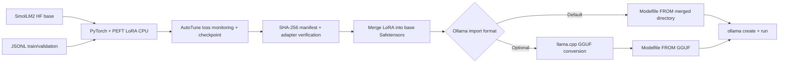

# AutoTune AI v0.9.2 | Hugging Face -> Fine-tuned Ollama Model (CPU)

**Status:** adapter/export integration and 258 Python tests pass offline in the build environment. **The actual SmolLM2 fine-tune, adapter merge, GGUF conversion, and Ollama deployment have not been run in this environment.** Preserve previous training `outputs/` and `mlflow.db`.

## Goal

Train a small original Hugging Face language model on Windows CPU using the existing AutoTune AI Hugging Face PEFT LoRA trainer, verify its adapter files, merge adapter weights with the *same exact base model*, and import the resulting model into Ollama. This is an additional **deployment adapter**, not an Ollama training implementation. No GPU/Unsloth needed.

Model: [HuggingFaceTB/SmolLM2-135M-Instruct](https://huggingface.co/HuggingFaceTB/SmolLM2-135M-Instruct), 135M parameters, Apache 2.0, Llama-family architecture. The demo has **16 train and 4 validation** examples, all formatted in ChatML-compatible user/assistant text and tailored to AI/ML basics. This tiny sample is designed for pipeline validation, **not quality benchmarking**.

## Architecture



### Step 0 - Backup existing project

Copy the patch into `C:\Users\Lenovo\Downloads\autoHeal_finetune` after backing up the current source. Do **not** replace or delete `.venv`, `outputs`, `mlflow.db`, or local model caches. Use a new output directory for this experiment.

### Step 1 - Confirm dependencies

```powershell
cd C:\Users\Lenovo\Downloads\autoHeal_finetune
.\.venv\Scripts\python.exe -m pip install -r requirements-lora.txt
.\.venv\Scripts\python.exe -m pytest -q
ollama --version
```

If `ollama` is not installed, get the Windows installer from https://ollama.com/download/windows and start the Ollama app. Keep Ollama bound to localhost. No Docker or GPU is required.

### Step 2 - CPU-only validation (does not download)

```powershell
.\.venv\Scripts\python.exe -m autotune.ollama_bridge plan --config config/lora_smollm2_ollama_cpu.yaml
```

This checks model ID, LoRA target modules, CPU setting, data hashes, split overlap, and 8 estimated update steps.

### Step 3 - Actual fine-tune on Windows CPU

```powershell
.\.venv\Scripts\python.exe -m autotune.hf_models_cli --config config/lora_smollm2_ollama_cpu.yaml --execute --output outputs/smollm2-ollama-01
```

This downloads original Hugging Face weights, runs PyTorch PEFT LoRA, evaluates and saves a final adapter + full Trainer checkpoint and manifest. It uses CPU, *not Ollama*, for weight updates. CPU performance varies; memory usage and runtime are not pre-verified. This first run exercises the trainer and monitoring, not automatic multi-attempt self-healing or a Meta API provider.

### Step 4 - Audit the adapter

```powershell
.\.venv\Scripts\python.exe -m autotune.ollama_bridge verify --config config/lora_smollm2_ollama_cpu.yaml --run outputs/smollm2-ollama-01
```

Stop if verification fails. A SHA-256 manifest detects changed files relative to the expected manifest; it does not prove that the original source was benign. Avoid editing the config or dataset between training and this step.

### Step 5 - Merge LoRA and preserve safe model artifacts

```powershell
.\.venv\Scripts\python.exe -m autotune.ollama_bridge merge --config config/lora_smollm2_ollama_cpu.yaml --run outputs/smollm2-ollama-01 --output outputs/smollm2-ollama-merged-01
.\.venv\Scripts\python.exe -m autotune.ollama_bridge verify-merge --merged outputs/smollm2-ollama-merged-01
```

The merge loads the same Hugging Face base weights onto CPU, merges the verified adapter, and saves a self-contained **Safetensors** directory with tokenizer and SHA-256 manifest. Do not try to deploy the adapter alone as a different model.

### Step 6A - Easiest Ollama import: merged Safetensors

Ollama documents importing a supported architecture from a local Safetensors directory. The SmolLM2 model is Llama-family, but the exact Windows Ollama version has not yet been live tested.

```powershell
.\.venv\Scripts\python.exe -m autotune.ollama_bridge modelfile --merged outputs/smollm2-ollama-merged-01 --output outputs/smollm2-ollama-Modelfile
ollama create autotune-smollm2:cpu -f outputs/smollm2-ollama-Modelfile
ollama run autotune-smollm2:cpu
```

At the interactive prompt, try `What is LoRA and why do we use it?`. Observe whether answers show relevant fine-tuning behavior; do not assume a small dataset produces significant model quality improvements.

### Step 6B - Optional reliable GGUF alternative

If the direct Safetensors import is not accepted by your Ollama installation, convert the **merged** directory with current llama.cpp. Only perform this after the verified merge. Set up llama.cpp tooling separately, following current https://github.com/ggml-org/llama.cpp documentation.

```powershell
# Optional: download the converter. Inspect its instructions before installing dependencies.
git clone https://github.com/ggml-org/llama.cpp.git .\external\llama.cpp
.\.venv\Scripts\python.exe -m pip install -r .\external\llama.cpp\requirements.txt
.\.venv\Scripts\python.exe -m autotune.ollama_bridge gguf --merged outputs/smollm2-ollama-merged-01 --converter external/llama.cpp/convert_hf_to_gguf.py --output outputs/smollm2-ollama-f16.gguf
.\.venv\Scripts\python.exe -m autotune.ollama_bridge modelfile --gguf outputs/smollm2-ollama-f16.gguf --output outputs/smollm2-gguf-Modelfile
ollama create autotune-smollm2:gguf -f outputs/smollm2-gguf-Modelfile
ollama run autotune-smollm2:gguf
```

GGUF import alone does **not** further quantize; f16 is the starting export. A compatible `llama-quantize` binary can optionally reduce the size, but quantization can affect accuracy. The CLI refuses to overwrite existing GGUF and Modelfile files. It runs the local converter explicitly rather than downloading any code on its own.

### Verification checklist

- `pytest` passes on user's Windows setup (the build environment passed **258**; local verification pending).
- `plan` shows `cpu_training: true`, model `SmolLM2-135M-Instruct`, 16/4 records, 8 estimated steps.
- Actual training completes and outputs `final_adapter` and checkpoint with normal metrics.
- `verify` reports successful manifest and model ID checks.
- Merge creates `model.safetensors` (or shards), `config.json`, tokenizer assets and manifest.
- `verify-merge` passes.
- Ollama lists the custom model and answers a test question. Keep base-model responses for a qualitative comparison.

### Security and current limitations

- **Do not use `trust_remote_code=True`.** This extension uses `False` and Safetensors for the merged output.
- This v0.9.2 example still uses model `revision: main`, which can change upstream. Pin the resolved immutable commit SHA for reproducible or security-sensitive runs; validate the model's license and provenance.
- Avoid untrusted `optimizer.pt` pickle files from third parties. This export path uses the final adapter + Safetensors only.
- Keep the Ollama, MLflow, and dashboard endpoints localhost-only and do not include private data or API keys in sample corpora.
- The current source does not automatically register merged models with MLflow or call a live Meta advisor on this path; those are future integration points.
- Training input is small and the current trainer computes causal LM loss over both user and assistant tokens; assistant-only label masking is an identified future enhancement.

## Official references

- HF model card: https://huggingface.co/HuggingFaceTB/SmolLM2-135M-Instruct
- Ollama import docs: https://github.com/ollama/ollama/blob/main/docs/import.mdx
- llama.cpp converter: https://github.com/ggml-org/llama.cpp
