<div class="cover">
  <div class="eyebrow">ENGINEERING HANDBOOK | LIVING EDITION</div>
  <h1>AutoTune AI</h1>
  <p class="cover-sub">An Agentic, Self-Healing MLOps Platform</p>
  <p class="cover-text">Architecture, training diagnostics, guarded hyperparameter recovery, Kubeflow orchestration, Meta advisor integration, implementation roadmap and verified baseline.</p>
  <p class="cover-meta">Version: v0.8.2 &nbsp;&nbsp; | &nbsp;&nbsp; Checkpoint: Real Tiny GPT-2 CPU LoRA success + artifact audit gate &nbsp;&nbsp; | &nbsp;&nbsp; 01 November 2026</p>
  <p class="cover-note">This handbook distinguishes CPU synthetic recovery from genuine small-model PyTorch training. Real tiny GPT-2 CPU LoRA training was user-verified. No hosted Meta API, Meta Llama GPU fine-tuning, optimizer resume, or production deployment is claimed.</p>
</div>
<div class="page-break"></div>

# v0.8.2 - Completed artifact checks and next real checkpoint-resume exercise

<div class="note"><b>User-confirmed Windows verification (2026-11-01):</b> The existing CPU LoRA run passed the read-only integrity audit of <b>six final-adapter files</b> and <b>ten full-checkpoint files</b>. A fresh base-model + LoRA adapter reload completed and generated <b>eight tokens</b>. The result reported best validation loss <b>10.365182876586914</b>. Neither audit resumed training: both explicitly reported <code>actual_resume_executed: false</code>. These are user-supplied terminal results, not executed in the document-build environment.</div>

## Why a separate resume exercise is necessary

The original completed output <code>outputs/gpt2-cpu-01</code> must remain read-only. A final adapter reload proves inference, but not continuation of the Trainer optimizer. Phase 5D introduces a **new** immutable four-step experiment: intentionally pause after step two, save complete Trainer state, verify hashes and run-state records, then invoke Trainer in a new process to continue from that same checkpoint.

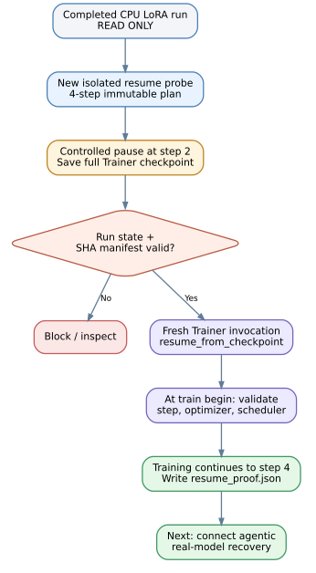{.diagram}

## Implementation contracts and acceptance evidence

| Boundary | Required behavior |
|---|---|
| Fresh probe | New output only; identical tiny public GPT-2 base and data |
| Pause gate | Step must be positive, aligned with evaluation/save, and less than total 4 |
| Checkpoint | SHA-256 manifest covers adapter, optimizer.pt, scheduler.pt, trainer_state.json, RNG |
| Resume gate | Only a verified `paused` run with matching config/data/plan/path/step |
| Training state | At train begin, observe restored step 2, nonempty optimizer state and scheduler progress |
| Completion | Continue past the old global step; write `resume_proof.json` and final adapter |
| Failure | Enter blocked state; no silent retry or in-place overwrite of completed reference |

Run the two commands from the extracted project root in VS Code PowerShell; a public model download may occur if the cache is cold:

```powershell
.\.venv\Scripts\python.exe -m autotune.hf_models_cli --config config/lora_cpu_resume_probe.yaml --execute --pause-after-step 2 --output outputs/gpt2-resume-probe-01
.\.venv\Scripts\python.exe -m autotune.hf_models_cli --config config/lora_cpu_resume_probe.yaml --execute --resume-checkpoint outputs/gpt2-resume-probe-01/checkpoints/checkpoint-2 --output outputs/gpt2-resume-probe-01
```

Inspect `outputs/gpt2-resume-probe-01/resume_proof.json`. The intended successful evidence is `trainer_begin_step: 2`, `trainer_end_step: 4`, `optimizer_state_nonempty_at_resume: true`, and `scheduler_last_epoch_at_resume >= 2`. **This outcome has not yet been observed**. It is a planned user-machine acceptance test; no live Trainer resume was executed in the build environment.

**Current test scope:** 185 offline tests passed (166 inherited, 19 new). These validate the pause/resume contracts and CLI wiring without requiring Hugging Face runtime dependencies. They do not verify training quality, numerical reproducibility or live optimizer restoration. See `docs/PHASE5D_OPTIMIZER_RESUME.md` for the operator runbook.

---

# Latest verified evidence - v0.8.2

<div class="note"><b>Independent user terminal checkpoint (2026-11-01):</b> Real PEFT LoRA fine-tuning of public <code>sshleifer/tiny-gpt2</code> succeeded on Windows CPU. The user reported one epoch, two training steps, four training and two validation examples, training loss about 10.4 and best validation loss <b>10.365182876586914</b>. There were <b>128 trainable LoRA parameters</b>, a saved final adapter, and a best full Trainer checkpoint at <code>outputs/gpt2-cpu-01/checkpoints/checkpoint-2</code>. These facts establish that the small-model training and saving path ran, not that the model learned useful language quality. Adapter reload was subsequently user-verified; optimizer resume and a real automatic recovery retry remain unverified.</div>

## New read-only audit and reload gate

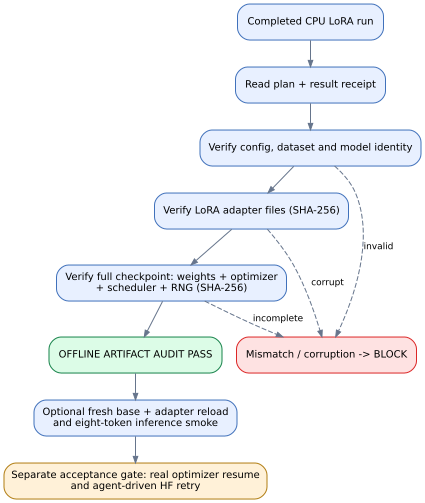{.diagram}

The audit first validates the completed run's provenance (`plan.json`, dataset/config hashes), then checks the final adapter SHA-256 manifest, and separately checks that the full Trainer checkpoint has hashed adapter, optimizer, scheduler and RNG files. It refuses files outside the run, mismatching receipts, incomplete results and changed datasets. A **successful file-integrity audit is not the same as actually resuming the optimizer**. Optional `--reload` freshly constructs the base model, applies the saved adapter and generates eight deterministic tokens; this is a load/inference test, not a benchmark.

From the exact project directory and existing `.venv` in VS Code PowerShell:

```powershell
.\.venv\Scripts\python.exe -m autotune.hf_audit_cli --config config/lora_public_cpu.yaml --run outputs/gpt2-cpu-01
.\.venv\Scripts\python.exe -m autotune.hf_audit_cli --config config/lora_public_cpu.yaml --run outputs/gpt2-cpu-01 --reload
```

The second line is optional and may download the base weights; run it only after the offline audit passes. Do not try to resume the already completed output in place. A dedicated interrupted-run exercise is the next critical training-integrity test.

**Verification scope:** 166 automated tests pass in the local build environment (153 inherited, 13 new artifact-audit cases), including tampered adapter, optimizer file corruption, mismatched model/data/config, path escape, interrupted run refusal and mocked reload integration. There is **no live HF inference run in this build environment**. Read `docs/PHASE5C_ARTIFACT_AUDIT.md` for implementation details and exact operations.

# Executive overview

**AutoTune AI** is a constrained feedback controller for ML training and fine-tuning. Instead of relying on a human to constantly inspect loss curves, it observes training events, detects potential generalization or numerical issues, preserves a known-good candidate and starts a new **bounded** experiment with verified parameters. A Meta model may advise the diagnosis and hyperparameters, but it cannot directly execute code or rewrite arbitrary files.

**Design promise:** *autonomous experiments; deterministic guardrails; auditable evidence; explicit release control.*

<div class="note"><b>Historical v0.7 evidence:</b> The user verified Phase 5A real PyTorch tiny-GRU training and 95 passing tests on Windows. New Phase 5B offline contracts, LoRA source pipeline and checkpoint manifest tests raise build-container coverage to 134 passing tests. Hosted Meta API, live Meta Llama GPU training, real Hugging Face optimizer resume, Kubeflow and remote MLflow remain unverified.</div>

## Core outcomes

- Detect likely overfitting, underfitting and non-finite loss during repeated evaluations.
- Capture the best validation checkpoint **from each attempt**, with clear artifact identity.
- Generate small remediation proposals, validate them against strict numeric limits, and rerun only within configured budgets.
- Preserve baseline configurations, decision logs and SHA-256 configuration identity.
- Separate **optimization** (validation metrics) from **final release acceptance** (held-out evaluation, policy, approval).

## Read this alongside

- `docs/MASTER_EXECUTION_PLAN.md` - all milestones, interfaces and exit criteria.
- `AGENTS.md` - compact history, decisions, pending items, verified checkpoints.
- `docs/diagrams/*.mmd` - editable Mermaid architecture and logic sources.
- `autotune/` and `tests/` - executable source and test evidence.

# 1. System architecture

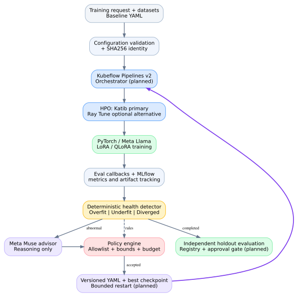{.diagram}

**Interface explanation.** A validated request moves from the configuration layer to an orchestrator. A training job emits evaluation metrics and writes checkpoints. A deterministic health analyzer determines whether to continue or stop. On a detected problem, the Meta agent optionally proposes a bounded patch; the policy engine decides whether to accept it. An approved patch creates a new versioned configuration and a new training attempt. Completion does not imply deployment: the model must pass independent release evaluation.

| Layer | Primary component | Responsibility | v0.7 status |
|---|---|---|---|
| Control plane | Python CLI / later FastAPI dashboard | Training request, configuration, run controls | Local CLI |
| Orchestration | Kubeflow Pipelines v2 | Pipeline tasks and retry scheduling | Example only |
| Optimization | Katib primary; Ray Tune alternative | Controlled hyperparameter search | Standalone Katib sample |
| Training | PyTorch, Hugging Face, PEFT LoRA | Model adaptation and checkpoints | Real tiny PyTorch CPU weights tested; Meta Llama PEFT GPU unverified |
| Observability | JSONL, optional MLflow | Metric history, experiments, artifacts | JSONL verified |
| AI intelligence | Meta Muse Spark advisor | Bounded numeric recommendations and deterministic fallback | Mock end-to-end + mocked transport tests; live API unverified |
| Trust boundary | Python deterministic policy | Allowlist, ranges, budgets, approval | Patch validation working |
| Quality | Holdout evaluation + model registry | Promotion assessment | Future phase |

## Component ownership

**Kubeflow orchestrates; Katib optimizes; MLflow records; Meta advises; the policy engine authorizes.** Ray Tune may replace Katib for selected experiments, but two independent HPO systems must never own one trial simultaneously. The agent must not read user secrets or raw training records by default.

# 2. Recovery and stopping lifecycle

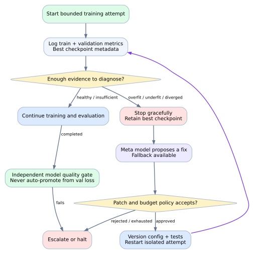{.diagram}

## Controller states

| State | Interpretation | Expected action |
|---|---|---|
| Insufficient evidence | Early run or missing history | Continue collecting reliable evaluations |
| Healthy / progressing | No stopping trigger | Continue until planned completion or budget |
| Suspected overfit | Validation worsens while train loss improves | Preserve best checkpoint; consider more regularization |
| Suspected underfit | Both losses plateau high relative to task-informed baselines | Diagnose data, capacity, LR and training budget |
| Diverged | NaN/Inf or unstable optimization | Immediate safe stop; do not blindly resume |
| Failed | Exception, missing artifact, OOM, policy violation | Audit and escalate or apply a specifically allowed retry |
| Completed | Attempt finished without stopping trigger | Validate model independently before promotion |

Phase 3 now implements a local durable CPU-mock state journal with idempotent receipt reconciliation, explicit blocked states and an operator-run recovery procedure. This is not distributed Kubernetes job cancellation.

## Why the best checkpoint matters

Validation loss may be lowest *before* overfitting becomes evident. Save the checkpoint corresponding to the minimum validation loss, rather than just the last epoch. If a hyperparameter change invalidates the optimizer state or adapter structure, begin a new attempt from the base model instead of assuming that warm-starting is safe. A synthetic JSON marker is **not** a restorable weight checkpoint.

# 3. Training metrics and diagnostic concepts

**Training loss** measures fit to training examples; **validation loss** helps assess generalization on held-aside validation examples. Their difference is a heuristic signal, not a universal definition of overfitting.

### Illustration: overfitting

Train loss trends downward while validation loss first improves and then rises. It can be reasonable to stop only after sustained validation deterioration and a meaningful train/validation gap. Small or noisy datasets can make such heuristics unreliable.

### Illustration: underfitting

Both train and validation loss can remain high or flat. Possible causes include too few updates, excessive regularization, weak representation capacity, mismatched labels, bad data, scheduler problems or an insufficient learning rate. A single numerical threshold cannot reliably diagnose underfitting across tasks.

### Illustration: divergence

Non-finite loss, gradient overflow or unstable updates merit a safe stop and investigation of learning rate, scaling, data corruption and numeric precision.

| Signal | Computation or source | Typical use |
|---|---|---|
| Train loss | Trainer callbacks | Optimization progress |
| Validation loss | Independent validation batches | Checkpoint selection and HPO objective |
| Generalization gap | `val_loss - train_loss` | Possible overfitting evidence |
| Validation perplexity | `exp(val_loss)` for token-level cross entropy | Language modeling context only |
| Accuracy, macro-F1, AUROC | Held-out evaluation tailored to task | Task quality; cannot be inferred from loss alone |
| LR and gradient norm | Optimizer and trainer hooks | Optimization stability |
| GPU memory/utilization | Driver and telemetry | Efficiency / OOM prevention |
| Tokens/sec, GPU hours, spend | Training logs and billing telemetry | Throughput and budget ceilings |

**Phase 2 now provides:** a typed per-evaluation metric contract, warning versus stopping actions, explicit evidence, limited conservative spike/plateau rules, JSONL auditing and offline replay. True step-aligned training windows, generic task metrics and independent GPU probes remain future work.

# 3A. Phase 2: telemetry pipeline and operational diagnosis

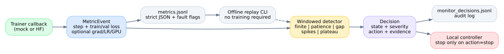{.diagram}

## Implementation inventory

| Code path | Purpose | Operational status |
|---|---|---|
| `autotune/metrics.py` - `MetricEvent` | Typed evaluation sample: positive step, train loss and validation loss; optional timestamp, LR, gradient and GPU peak memory | Tested with synthetic and invalid inputs |
| `autotune/metrics.py` - `diagnose` | Windowed conservative diagnosis, severity/action classification and numerical evidence | Tested |
| `autotune/metrics.py` - `MonitorStream` | Accumulate observations, emit a decision for every evaluation to JSONL | Integrated and tested in mock trainer |
| `autotune/tracking.py` | Strict JSON-safe metric history, nonfinite markers with null values, optional MLflow | JSONL tested; external MLflow not tested |
| `autotune/monitor_cli.py` | Replay `metrics.jsonl` offline into a comprehensive JSON decision report | Tested |
| `autotune/mock_trainer.py` | Feed live mock events through monitor and stop only on action=`stop` | End-to-end simulation verified |
| `autotune/hf_trainer.py` | Same monitor call during HF evaluation callback | Source adapted; no real GPU test |

## Event and decision contracts

```json
{
  "step": 6,
  "train_loss": 0.98,
  "val_loss": 1.79,
  "learning_rate": 0.0001,
  "grad_norm": 12.2
}
```

Each event represents the last available train metric paired with an evaluation metric. Required: positive increasing `step`, numeric `train_loss`, numeric `val_loss`. Optional fields: timestamp, learning rate, gradient norm, peak GPU allocation. The logger provides an external UTC audit timestamp. Future work should align train-loss averaging windows precisely to evaluation steps in the HF adapter; the current `on_log` snapshot can lag the validation window.

Example decision structure, stored in `monitor_decisions.jsonl`:

```json
{
  "state": "overfit",
  "explanation": "Validation loss rose for 2 evaluations while train loss fell; gap=0.810",
  "severity": "critical",
  "action": "stop",
  "evidence": {"step": 6, "gap": 0.81, "patience": 2, "best_val_loss": 1.57}
}
```

**Stop semantics are explicit:** the training callback must inspect `action`, not assume every named anomaly means a stop. `info` and `warning` decisions continue training. Severe errors such as nonfinite loss can request termination immediately even before a warmup window completes.

## Diagnostic matrix and false-positive protection

| Signal | Necessary evidence | Classification | Current behavior |
|---|---|---|---|
| Warmup | Fewer than `min_evaluations` paired events | Info / continue | No stop |
| Missing or repeated steps | Missing metric or non-monotonic evaluation sequence | Warning / continue | Signals insufficient evidence |
| Nonfinite value | NaN/Inf loss or gradient norm | Critical / stop | Trial stop; no automatic divergence patch yet |
| Isolated train+val spike | Both losses jump above configured ratio in one evaluation | Warning / continue | Require confirmation |
| Repeated train+val spikes | Multiple consecutive jumps exceed `loss_spike_ratio` | Critical / stop | Stop to avoid uncontrolled divergence |
| Overfit heuristic | Validation rises every patience observation; train improves; gap exceeds threshold | Critical / stop | Preserve best simulated checkpoint marker |
| High flat losses | Both losses remain high and near-flat for full window | Critical / stop | Task-specific floor may need calibration |
| Low flat losses | Both losses flat but not over underfit floor | Warning / continue | Not proof of underfitting |
| High finite gradient norm | Latest grad norm exceeds `grad_norm_warning` | Warning / continue | Not auto-stop without trend evidence |

Underfit and overfit labels are *heuristic findings*; they do not establish that the model is truly underfitting or overfitting across all tasks. A genuine research or production project should calibrate thresholds on data scale, dataset size, model family and training objectives.

## Offline replay / reproducibility

From VS Code PowerShell:

```powershell
.\.venv\Scripts\python.exe -m pytest -q
.\.venv\Scripts\python.exe -m autotune.orchestrator --mode mock --no-writeback
.\.venv\Scripts\python.exe -m autotune.monitor_cli --file "runs\YOUR_RUN_FOLDER\trial-01\metrics.jsonl" --config config/baseline.yaml --output "runs\monitor_report.json"
```

Expected benchmark-free demonstration: 36 local Python tests passed; synthetic overfit at step 6 in attempt one, a second attempt completes, with best **simulated** val loss 0.58. Actual Llama GPU fine-tuning and Kubeflow/MLflow production connections are not evidenced here.

## Known technical limitations and next phase

1. `MetricEvent` validates only essential loss fields and limited optional signals; no universal accuracy, F1 or dataset-quality metrics yet.
2. Date/timestamp is recorded but ISO timestamp parsing / clock drift validation is not enforced.
3. Very noisy datasets can defeat monotonic-patience rules; tune thresholds with task-specific baselines before GPU usage.
4. Missing metric records do not stop, though a production controller should escalate after a configurable missing-data timeout.
5. The policy fallback does not auto-remediate divergence. The Phase 3 durable mock controller fails closed instead of retrying blindly.
6. `monitor_decisions.jsonl` is per-trial audit evidence; Phase 3 now adds atomic LOCAL journal and simulated checkpoint validation. Distributed job reconciliation and real checkpoint validation remain future work.

# 4. LLM safety and codebase change boundary

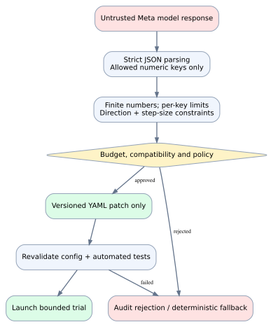{.diagram}

The advisory agent returns a structured object such as:

```json
{
  "patch": {
    "learning_rate": 0.00008,
    "lora_dropout": 0.15,
    "weight_decay": 0.03
  }
}
```

**An agent proposal is not permission.** The engine checks allowed keys, finite values, absolute bounds, maximum per-attempt change and diagnosis-specific directional rules. Existing v0.1/v0.3 policy supports `learning_rate`, `weight_decay`, `lora_dropout`, `num_train_epochs`, `lora_r`, and `gradient_accumulation_steps`. Any unknown parameter or executable instruction is rejected.

Phase 9 will add **Git branch -> patch -> CI -> review/approval -> merge -> restart** for configuration or limited code changes. We must not let an LLM arbitrarily rewrite `.py`, import untrusted training scripts or run commands. When remote Meta access fails, the deterministic fallback can be used if policy accepts it.

## Operational stop conditions

- Retry ceiling reached; no approved patch; no trustworthy checkpoint; invalid/nonfinite metrics.
- GPU or financial budget exceeded; unsupported device precision; repeated OOM or external API failure.
- Unapproved model, unlicensed dataset, data leak risk or failed quality/evaluation gate.

# 4A. Phase 3: durable and safe recovery (v0.4)

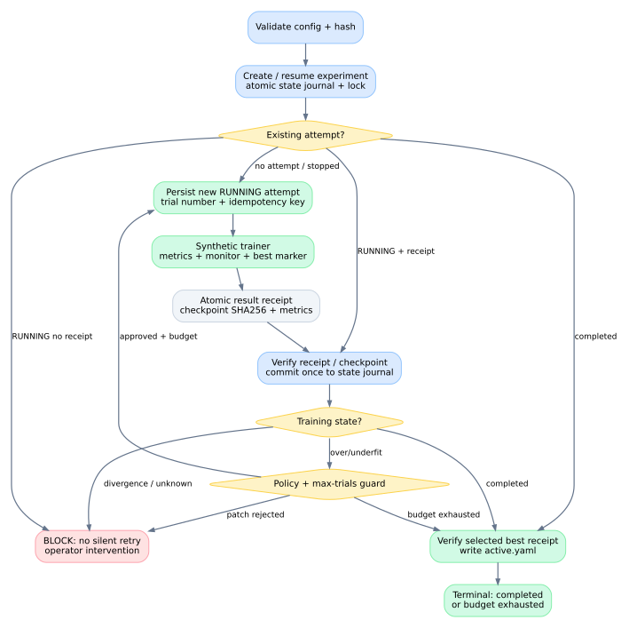{.diagram}

## Why persistence is necessary

In Phase 2 an in-memory process controlled several simulated trials. A process kill could happen after training finished but before an attempt was recorded, resulting in duplicate GPU spending or invalid artifact selection. In Phase 3 each attempted operation has a durable state before starting and an atomic result receipt after finishing. Resume reconciles these two independent records rather than blindly repeating work.

## State and transition contract

| State or marker | Written when | Resume behavior |
|---|---|---|
| `running` attempt | Before invoking the trainer | Inspect `result_receipt.json` first |
| Valid result receipt | After the trainer returns, with checkpoint SHA256 | Commit exactly once, never rerun finished attempt |
| `stopped` | Verified monitor signal indicates over/underfit or another stop | Only over/underfit with approved patch can retry |
| `completed` attempt | Finished training without monitored stop | Experiment terminates and checks best checkpoint |
| `abandoned` | Operator confirmed an unreceipted prior job ended | Trial number counts against budget; retry is explicit |
| `blocked` experiment | Uncertain job, bad receipt, invalid checkpoint or unsafe condition | Human investigation; no automatic retry |
| `budget_exhausted` experiment | Trial count reaches max while verified candidate exists | Keep best candidate but no release promotion |
| `completed` experiment | A complete attempt exists and best marker is verified | No-op on repeated resume |

**Idempotency:** each attempt has a stable SHA256 idempotency key combining experiment ID, trial number and configuration hash. The journal at `recovery_state.json` is the authoritative record; `recovery_events.jsonl` supports incident analysis but can lag a journal transition if the host crashes at the wrong moment. Completion receipts include attempt identity, config SHA256, simulated checkpoint SHA256 and best validation metrics. A correct receipt may be safely committed after restart.

**Crash uncertainty:** with state=`running` and no valid receipt, the recovery engine will refuse to start another attempt automatically. The operator must verify no training job is alive, then use an explicit abandon action; it consumes a trial slot. Untrusted or mismatched receipts fail closed. A local exclusive `.controller.lock` blocks concurrent writers; clearing a stale lock requires explicit operator acknowledgement that no controller remains active.

## Source and executable interfaces

| Module / file | Responsibility |
|---|---|
| `autotune/recovery.py` | Local state machine, atomic JSON, locks, receipts, checksum verification, retry and best-state selection |
| `autotune/recovery_cli.py` | Windows-friendly new-run and resume CLI; operator interventions require flags |
| `tests/test_recovery_phase3.py` | Fault injection, idempotent completion, corruption, lock refusal, baseline-change refusal, budget and opt-in writeback |
| `docs/PHASE3_RUNBOOK.md` | Operator recovery procedure, command examples and safety boundaries |
| `run_phase3.ps1` | Doctor, test suite and durable synthetic demo |

## Implementation sequence and restart behavior

1. Validate baseline YAML and calculate its stable SHA256 before creating a fresh experiment.
2. Write a journal, atomically write each attempt config, acquire the experiment lock and record the `running` attempt before invoking the trainer.
3. Receive evaluation metrics from the existing Phase 2 monitor and let the mock trainer create its best-checkpoint **JSON metadata marker**.
4. Hash the artifact and write an atomic `result_receipt.json`; match the trial ID, config hash, best step and loss against checkpoint metadata.
5. Atomically commit the verified result and update `best_config.yaml` only when validation loss improves; if stopped for overfit/underfit, apply a bounded deterministic patch and start another numbered attempt.
6. On completion or exhausted budget, re-verify the winning receipt/marker before writing `active.yaml`. Never run test-set evaluation or automatic model deployment at this point.
7. If interrupted, reconcile a valid receipt without rerunning; block if work is uncertain, corrupted or unsupported. Resume requires the same baseline config fingerprint.

```powershell
# Phase 3 new CPU-mock experiment
.\.venv\Scripts\python.exe -m autotune.recovery_cli --config config/baseline.yaml --workspace runs

# Reconcile a previous experiment after verifying no active external job
.\.venv\Scripts\python.exe -m autotune.recovery_cli --config config/baseline.yaml --resume 'runs\YOUR_EXPERIMENT'

# Only if prior job definitely stopped and no receipt exists
.\.venv\Scripts\python.exe -m autotune.recovery_cli --config config/baseline.yaml --resume 'runs\YOUR_EXPERIMENT' --abandon-interrupted
```

## Validated tests and limitations

**Verification:** 48/48 tests passed locally on Python 3.13, adding 12 Phase 3 tests to the 36-test v0.3 suite. Simulated failure points include after recording RUNNING, after training but before receipt, and after receipt but before journal commit. Valid receipts reconcile without duplicated metrics. Corrupted checkpoint hashes prevent selection; the abandoned trial counts against the retry ceiling. A second identical resume on a terminal experiment does not emit new events.

**Limits:** Phase 3 only supports synthetic CPU training through the new durable CLI. It does not yet implement durable PyTorch weight checkpoints, cross-process Kubernetes job reconciliation, distributed locks, real hardware cost quotas, codebase Git commits or live Meta API reasoning. `SHA256` proves local bytes match a recorded digest, not that the model is trustworthy or loadable. The old `autotune.orchestrator` is retained for backward compatibility, but it is not the new crash-safe controller. Testing on the user's Windows host is still required.

# 4B. Phase 4: Meta advisor integrated into durable recovery (v0.5)

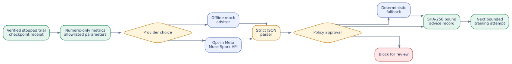{.diagram}

## What was actually implemented

Phase 4 introduces `autotune/advisor.py` and `autotune/advisor_cli.py`, connects validated advice to Phase 3's `run_durable` controller, and adds `config/agent_mock.yaml` for zero-cost CPU validation. The same recovery loop can be configured for a hosted Meta Muse Spark recommendation, but **a successful real external API call has not been executed or claimed**. The default `config/baseline.yaml` continues using the pre-existing deterministic rule engine, protecting Phase 3 compatibility.

The Meta endpoint and model identifiers are drawn from Meta's public Model API documentation (checked 2026-11-01): `https://api.meta.ai/v1` and `muse-spark-1.3`, through an OpenAI-compatible Chat Completions request. An API key remains in the `MODEL_API_KEY` environment variable, never in the training configuration. The optional network call is bounded by a 20-second client timeout and zero client retries. Offline mock and network failure do not require credentials.

### Interface contracts

| Contract | Input | Valid output | Rejection / fallback |
|---|---|---|---|
| Advisor input | Diagnosis + last eight allowlisted metric dictionaries + six numeric training parameters | Sanitized JSON only | Raw samples, commands, file paths and secrets never included |
| Model response | Strict JSON object with `patch`, optional matching `diagnosis` and short `rationale` | Numeric patch with allowlisted keys | Non-JSON, duplicate JSON keys, unknown fields, oversized output, contradictory diagnosis and bad types rejected |
| Policy engine | Proposed patch + current configuration + original monitor diagnosis | Bounded direction-aware hyperparameter delta | Unapproved values and changes rejected, deterministic safe fallback attempted |
| Durable snapshot | Trial number, config SHA-256, checkpoint SHA-256, validated patch, output config SHA-256 | `trial-XX/advisor_decision.json` with its own hash | Altered or inconsistent saved decision blocks replay |
| Controller | Validated candidate configuration, finite attempt budget | New versioned CPU-mock training attempt | Divergence or unsupported cause blocks automation |

### Why this boundary matters

A language model can output malformed JSON, non-finite numbers, duplicate keys, off-policy parameter changes, or text designed to trigger dangerous actions. Phase 4 handles all model replies as **untrusted data**: the assistant cannot request terminal access, execute arbitrary code, see training records or secrets, edit Python files, or authorize promotion. A separate Python validator checks every suggested parameter. The saved recommendation is bound to the exact stopped attempt and checkpoint and is **replayed rather than recomputed** after an interruption.

The deterministic fallback does not promise better performance: it only makes a bounded, policy-consistent candidate. The model must still be trained and evaluated before any quality conclusion. A CPU mock scenario uses synthetic losses and a JSON metadata checkpoint, not real gradients or Meta Llama weights.

### Example synthetic recovery trace

1. Trial 1 emits falling train loss but rising validation loss after its optimum; the monitor stops it with an overfit diagnosis.
2. Phase 3 validates the mock checkpoint marker digest and commits the receipt to durable state.
3. The Phase 4 mock advisor proposes `lora_dropout: 0.15`, `weight_decay: 0.03`, and `learning_rate: 0.00008` from starting values `0.05`, `0.01` and `0.00010`.
4. The deterministic policy verifies values and directions. The controller writes `trial-01/advisor_decision.json` with both config hashes and the checkpoint hash.
5. The controller starts trial 2 from the baseline simulator with the new configuration. The scripted loss curve ends at validation loss **0.58**, which is **synthetic** and not a real model accuracy claim.
6. On restart, a saved advisor decision is independently revalidated; a tampered snapshot blocks instead of making a fresh API call and overwriting audit history.

### CLI implementation and reproducibility

```powershell
py -3.13 -m venv .venv
.\.venv\Scripts\python.exe -m pip install -r requirements.txt
.\.venv\Scripts\python.exe -m pytest -q
.\.venv\Scripts\python.exe -m autotune.advisor_cli --provider mock --diagnosis overfit
.\.venv\Scripts\python.exe -m autotune.recovery_cli --config config/agent_mock.yaml --workspace runs
```

An optional hosted test is **explicit**: set `MODEL_API_KEY` securely and invoke `python -m autotune.advisor_cli --provider meta --diagnosis overfit` (after installing the optional `openai` client). API access might be billable; absence of a key produces a visible deterministic fallback, not fabricated remote inference. See `docs/PHASE4_RUNBOOK.md` for Windows and PowerShell specifics.

**Verification evidence:** 77/77 local Python tests passed, including 29 new Phase 4 tests for malformed/adversarial responses, injection-safe payload selection, missing credentials, replay consistency, tamper rejection and an end-to-end synthetic durable recovery. The actual hosted endpoint was not contacted. No GPU, Kubeflow cluster, actual weight checkpoints, or real measured improvements were used.

# 4C. Phase 5A - Genuine PyTorch training with verified weight checkpoints (v0.6)

<div class="note"><b>Verification scope:</b> A small byte-level GRU language model was genuinely trained on the bundled JSONL instructions using offline PyTorch CPU, with real backpropagation and optimizer updates. The optional Hugging Face Meta Llama LoRA adapter in <code>autotune/hf_trainer.py</code> is still NOT GPU-tested; this is not a claim of real Meta Llama fine-tuning or state-of-the-art quality.</div>

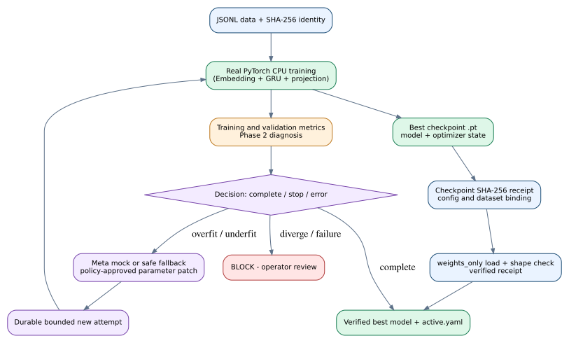{.diagram}

## Why this phase is different from the earlier simulation

Phases 1-4 replayed deterministic simulated metrics and stored <code>best_checkpoint.json</code> as **metadata**, not model weights. Phase 5A introduces <code>autotune/real_training.py</code>, which computes token-level cross-entropy, calls <code>loss.backward()</code>, updates parameters with AdamW, evaluates on a separate validation set and saves actual tensors to <code>best_checkpoint.pt</code>. The byte model uses an embedding, a GRU and a linear vocabulary projection; it is randomly initialized and is not a pretrained Meta model. Phase 5A does **not** claim fine-tuning of pretrained weights.

## End-to-end implementation

1. **Dataset access and provenance.** Read JSONL records with a mandatory <code>text</code> field. Require at least two records per split, separate training and validation content, and a bounded local file size. Calculate a SHA-256 identity over both file digests and their explicit split roles. Do not send text records to the advisor.
2. **Tokenization and labels.** Encode UTF-8 into byte IDs (0-255). Input tokens predict their next byte. Mask padding positions with <code>-100</code> in cross-entropy. This is an intentionally lightweight architecture for testing rather than a production text tokenizer.
3. **Weight updates.** Train with AdamW, gradient clipping and deterministic example order. Each epoch produces an average training loss and a separately computed validation loss. The training loss is averaged during the epoch, not recomputed after the epoch; it is a trend estimate rather than perfectly synchronized with validation loss.
4. **Signal monitoring.** Write metrics to <code>metrics.jsonl</code>, diagnostic decisions to <code>monitor_decisions.jsonl</code>, and run the existing evidence-window rules to stop at an epoch boundary when warranted. These heuristics may misclassify short or noisy runs.
5. **Checkpoint save.** On each improvement, atomically replace <code>best_checkpoint.pt</code> with model weights, optimizer state, epoch, validation score, configuration hash and dataset hash. This supports verification and loading; partial-epoch optimizer resume is not yet implemented.
6. **Durable controller.** <code>autotune/real_recovery.py</code> uses a separate <code>real-torch-v0.6</code> journal schema, creates a receipt containing the exact file SHA-256 and selects a best checkpoint only after verifying checksum, identities, state dictionary shapes and optimizer loadability with <code>torch.load(weights_only=True)</code>.
7. **Controlled recovery.** A stopped overfit/underfit attempt can request an allowlisted patch through the existing offline advisor/fallback engine and start a new bounded attempt. The model restarts from a fresh initialization when parameters change. Uncertain RUNNING work without a receipt is blocked; no silent re-execution occurs. Divergence also blocks rather than blindly retrying.

## Actual measured CPU smoke test

| Epoch | Train loss | Validation loss |
|---|---:|---:|
| 1 | 5.5887 | 5.6072 |
| 2 | 5.5706 | 5.5941 |
| 3 | 5.5538 | 5.5808 |
| 4 | 5.5384 | 5.5675 |

The smoke test completed one trial and selected epoch 4; its actual tensor checkpoint was hash-verified and loadable. These values demonstrate execution only, not model quality or comparison with an established baseline. A deliberate threshold-manipulation test also exercises two real-weight attempts and budget exhaustion; its *underfitting classification is forced for state-machine coverage*, not proof of a genuine learning failure.

**Verification evidence:** 95/95 automated tests passed locally with PyTorch CPU (77 inherited plus 18 new tests), including real gradient backpropagation, JSONL/dataset integrity, weight and optimizer checkpoint loading, digest/tamper failures, completed-run idempotency, dataset mutation rejection, uncertain RUNNING blocks and bounded retry. The user subsequently confirmed Phase 5A on Windows: 95 tests passed and a loadable tensor checkpoint was produced.

## Run on Windows in VS Code

```powershell
py -3.13 -m venv .venv
.\.venv\Scripts\python.exe -m pip install -r requirements-real-cpu.txt
.\.venv\Scripts\python.exe -m pytest -q
.\.venv\Scripts\python.exe -m autotune.real_cli --config config/real_cpu.yaml --workspace runs_real
```

If script execution is allowed, <code>.\run_phase5.ps1</code> runs the tests and CPU training. Do not set system-wide unrestricted PowerShell execution policies merely to run it. Inspect <code>runs_real/&lt;id&gt;/trial-01/best_checkpoint.pt</code>, <code>result_receipt.json</code>, <code>recovery_state.json</code>, <code>active.yaml</code>, and event/metric logs. The phase requires PyTorch and may need a compatible wheel for Windows/Python; no API key, GPU or network model download is necessary after installation.

## Stage 5B background and outstanding live Meta Llama validation gate

The existing <code>autotune/hf_trainer.py</code> is **source only and not GPU validated**. Before claiming full Phase 5, exercise a licensed Meta Llama variant with the supported Transformers, PEFT, Accelerate and GPU stack, validate tokenizer and masking semantics, use aligned metrics, verify adapter reload/inference, save optimizer/scheduler state where supported, handle interrupted trials and record GPU memory and data/model revision hashes. The CPU GRU checkpoint is **not interchangeable** with HF/LoRA checkpoints. Neither pipeline is production release-ready.


# 4D. Phase 5B - Meta Llama / Hugging Face LoRA integration (v0.7)

<div class="note"><b>Verification boundary:</b> The new LoRA pipeline is source-complete for an optional, explicitly triggered pilot and passed offline contract tests. No Meta model weights were downloaded, no GPU fine-tuning was run, and Hugging Face Trainer's real checkpoint behavior has not been exercised in this build. The user's Phase 5A Windows run (95 tests) trained the separate tiny-GRU model, not Llama. This release advances integration readiness, not a completed on-GPU milestone.</div>

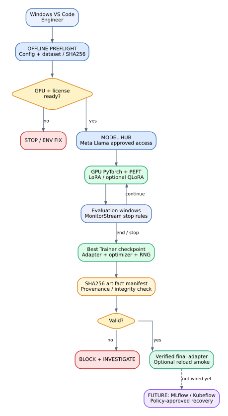{.diagram}

## Why LoRA and QLoRA are useful

LoRA (Low-Rank Adaptation) freezes a pretrained base model and trains a small number of low-rank update matrices in selected layers. This reduces the number of trainable parameters compared with full fine-tuning. QLoRA loads base weights at reduced precision (commonly 4-bit) while learning LoRA adapters. Neither approach guarantees lower loss or better model quality; memory efficiency and stability depend on the actual hardware, libraries and dataset.

On a GPU server, the plan selects a Meta Llama model, validates authorized model access, tokenizes train/validation JSONL, attaches PEFT adapters to `q_proj` and `v_proj`, and runs Hugging Face Trainer. The offline plan does not make external requests and rejects missing/duplicate splits and configurations that schedule no validation. A separate public `sshleifer/tiny-gpt2` CPU config provides an optional online dependency smoke test.

## New code and ownership

| Module | Responsibility | Verified scope |
|---|---|---|
| `autotune/lora_contract.py` | Offline config/data hash check, split duplication detection, evaluation schedule plan, SHA256 checkpoint manifests | 39 new offline tests together with CLI/guardrails |
| `autotune/lora_cli.py` | Default safe preflight; explicit `--execute`, `--resume-checkpoint`, `--verify-adapter` | Offline planning tested |
| `autotune/lora_gpu.py` | PEFT LoRA/optional QLoRA, GPU guard, HF Trainer callbacks, adapter save/reload | Source-level integration; real HF run not yet tested |
| `config/lora_meta_gpu.yaml` | Licensed Meta Llama 3.2 1B pilot config | Validated, not downloaded |
| `config/lora_public_cpu.yaml` | Public tiny GPT-2-derived CPU training example | Validated, not downloaded |
| `docs/PHASE5B_RUNBOOK.md` | Windows and optional remote AMD ROCm/NVIDIA GPU steps | Documented, not executed |

## Correct metrics and checkpoint semantics

The Hugging Face callback collects a training-loss log at the same evaluation cadence (currently `logging_steps == eval_steps`). At evaluation, it pairs the mean of newly logged training-loss values with the validation loss. If no corresponding training loss exists, it writes an `unpaired_evaluation` event and **does not invent a pair or issue a stop**. The monitor uses existing conservative heuristics and can request the Trainer to stop and save at the next safe control boundary.

A *full training checkpoint* includes an adapter `adapter_model.safetensors`, `adapter_config.json`, `trainer_state.json`, `optimizer.pt`, `scheduler.pt`, and RNG state. The separate `final_adapter/` is suitable for inference reload but **is not guaranteed to restore training optimizer state**. Hash manifests bind artifact files to configuration/model/dataset identities and reject missing, extra or modified files. Hashes are not signatures; untrusted optimizer pickle files must never be resumed.

**Important integration boundary:** The old Phase 5A tiny-GRU `.pt` checkpoint and the new HF Trainer/PEFT checkpoint are not interchangeable. The HF pilot is not yet attached to Phase 3/4 durable self-healing retry logic. An operator must explicitly start a GPU run and explicitly select a trusted in-run checkpoint to resume. Automatic GPU parameter tuning and requeue are future work.

## Agent boundary, model licensing and compute

Meta Muse Spark remains a *diagnostic advisor* in the existing CPU controller, never a shell executor or direct repository editor. It is **not automatically called** by the new HF pilot. Meta Llama model downloads require approved license access through Hugging Face. The base model revision is configurable; default `main` is a moving reference and must be pinned to a commit for strict reproducibility. Trusting remote model code is disabled in the pilot.

For AMD MI300X, select compatible Linux ROCm PyTorch wheels and validate the relevant PEFT and bitsandbytes build before enabling 4-bit QLoRA. `torch.cuda.is_available()` is also used by ROCm-enabled PyTorch; a Windows CPU installation alone cannot satisfy GPU deployment. For NVIDIA use a compatible CUDA stack. No GPU throughput, GPU memory or cost results are claimed in this edition.

## Phase 5B test record and Windows validation

The user independently verified **95 passed in 34.36s** on their Windows host in Phase 5A, plus a real tiny-GRU best validation loss `5.567494869232178` and SHA256 checkpoint receipt. A PyTorch NumPy warning was nonfatal, so the new `requirements-real-cpu.txt` includes `numpy`. This v0.7 build adds 39 offline tests, bringing the build environment to **134/134 passing**. Tests cover invalid LoRA configurations, missing validation windows, data leakage, tampered/missing artifact files, hash-bound provenance, symlinks, locking, GPU absence and token label padding. **Fake test artifact bytes do not constitute trained adapter weights.**

On Windows in VS Code (no HF model download):

```powershell
.\.venv\Scripts\python.exe -m pip install numpy
.\.venv\Scripts\python.exe -m pytest -q
.\.venv\Scripts\python.exe -m autotune.lora_cli --config config/lora_meta_gpu.yaml
```

Optional public online CPU smoke and GPU execution commands are detailed in `docs/PHASE5B_RUNBOOK.md`. Execute those before marking the actual GPU/adapter gate complete. This is **not a production benchmark or safety certification**.

## Risks and next release gate

The live HF/PEFT dependency matrix, Meta repository permissions, compatibility of checkpoint file layouts across Trainer versions, ROCm/CUDA kernels, actual optimizer resume, model inference, GPU OOM and VRAM metrics remain to be validated. The training callback is conservative and does not prove that two correlated loss numbers represent equivalent distributions. Final quality evaluation must use an untouched holdout and a separately approved promotion policy.

**Next milestone: Phase 6** after a verified LoRA GPU run - connect real adapter artifacts and evaluation metrics to a persistent MLflow tracking server; only then integrate those jobs with durable Kubeflow-owned recovery. Continue to refresh the PDF handbook, roadmap and AGENTS.md for every active iteration.

# 5. Full phased implementation program

| Phase | Scope / deliverable | Exit gate | State |
|---|---|---|---|
| 0 | Requirements, architecture, docs | Baseline agreed, living docs present | Complete |
| 1 | Package, validation, doctor, tests | Local mock and tests pass | Complete |
| 2 | Metric contract, diagnostics | Noisy/missing/divergent cases tested | Complete - 36 total tests at Phase 2 |
| 3 | Recovery state machine | Idempotent stop/checkpoint/retry tests | **Complete - 48 total tests** |
| 4 | Meta diagnostic agent | Strict JSON and adversarial-output tests | Complete - 77 total CPU-mock tests at Phase 4 |
| 5 | Real PyTorch CPU (5A) + Llama LoRA (5B) | Loadable CPU weights; then supported GPU adapter validation | **5A user-verified; 5B contract tested (134 total); live GPU pending** |
| 6 | MLflow infrastructure | End-to-end run lineage and artifact store | Planned |
| 7 | Kubeflow deployments | Cluster pipeline launches bounded attempts | Planned |
| 8 | Katib / Ray Tune | Verified optimizer selection and trial search | Planned |
| 9 | Git-reviewed changes | PR, tests, rollback, approval policy | Planned |
| 10 | Unified dashboard | Live metrics, timeline, controls and alerts | Planned |
| 11 | Quality/policy gates | Held-out evaluation and model registry | Planned |
| 12 | Production hardening | Reproducible installation and tested runbook | Planned |

**Critical path:** Phases 0-4 completed as CPU mock; Phase 5A real tiny PyTorch weights verified. **Next:** Phase 5B live GPU verification, then Phase 6 MLflow. Add MLflow persistence before moving recovery onto independent Kubernetes jobs; then add Katib. The dashboard can grow incrementally but the final promotion gate follows robust evaluation.

## Deliverable acceptance by phase

**Phase 2:** typed metric events, paired train/eval event contract, robust anomaly tests, diagnosis evidence.

**Phase 3 (mock complete):** durable local transitions, attempt keys, simulated checkpoint SHA256 verification, failure injection, safe resume. Real weight-checkpoint compatibility remains Phase 5+ work.

**Phase 4 (CPU mock complete):** strict Meta response schema, offline integration, privacy allowlists, failed-call fallback, persisted advisor decision and tamper/replay tests; hosted API connection still unverified.

**Phase 5A:** real small PyTorch CPU weights + checkpoint validation verified. **Stage 5B outstanding:** actual Meta Llama LoRA adapter weights and repeatable validation loss from a supported GPU.

**Phases 6-8:** MLflow tracking, Kubeflow job isolation and Katib-controlled search with safe ownership.

**Phases 9-12:** governed Git changes, UI, holdout and model registry, deployment/performance/security checks.

# 6. Phase 1 - implementation record

**Starting point:** Existing v0.1 CPU-only synthetic controller, metric heuristics, patch allowlist, optional Meta/MLflow hooks, HF LoRA adapter, Kubeflow pipeline definition and Katib example. The user-provided starter's historical tests were 8 passing; no real GPU/KFP deployment had been verified.

**Added in v0.3:**

1. `autotune/config.py` validates baseline structure and critical parameters before a run starts. It rejects invalid numeric values, booleans masquerading as numeric values, malformed YAML, invalid budgets, invalid LoRA ranks and identical train/validation files. It produces a content-stable SHA-256 config fingerprint.
2. `autotune/doctor.py` exposes `--mode mock|hf` to check the local environment and emit JSON status without printing API secrets.
3. `autotune/orchestrator.py` now loads the validated configuration before creating a run directory and puts the SHA-256 content identity into the experiment manifest.
4. `tests/test_config.py` adds seven tests across contracts, invalid values, no-side-effect failures and environment checks.
5. Master plan, diagrams and maintained AGENTS.md have become first-class project artifacts.

## Test results from this session

```text
python -m pytest -q
...............     [100%]
15 passed in 0.12s

python -m autotune.doctor --mode mock
"ok": true
```

**Synthetic recovery:** attempt 1 detected overfitting at evaluation step 6; its best simulated validation loss was 1.57 at step 4. Attempt 2 completed the mock curve with best validation loss 0.58. These numbers are intentionally generated by a deterministic test harness and **must not be cited as real model accuracy or comparative improvements.**

**Environment of verification:** Python 3.13 in the working container, with installed PyYAML and pytest. Commands for Windows Python 3.11 are provided but have not been executed on the user's machine.

# 7. How to run Phase 1 in VS Code (Windows)

Extract the project ZIP, open `AutoTune_AI_Phase1` in VS Code and use its integrated PowerShell terminal. From the extracted project root:

```powershell
py -3.11 -m venv .venv
.\.venv\Scripts\python.exe -m pip install -r requirements.txt
.\.venv\Scripts\python.exe -m autotune.doctor --mode mock
.\.venv\Scripts\python.exe -m pytest -q
.\.venv\Scripts\python.exe -m autotune.orchestrator --mode mock --no-writeback
```

The final command creates a new `runs/<timestamp>/` experiment directory with `manifest.json`, `summary.json`, event history, trial metrics, YAML configs and synthetic checkpoint metadata. `--no-writeback` leaves `config/optimized.yaml` unchanged; remove that flag when explicitly testing controlled config writeback.

For optional MLflow + dashboard, install `requirements-optional.txt` and configure a local tracking server as outlined in the README. This is optional for the local simulation; it is not necessary for the 48-test suite.

## Common problems and resolutions

| Symptom | Likely cause | Next action |
|---|---|---|
| `py -3.11` not recognized | Python launcher/Python 3.11 not installed | Install Python 3.11 and verify `py --list` |
| PowerShell activation blocked | Execution-policy restrictions | Call `.venv\Scripts\python.exe` directly; no activation required |
| `ConfigError` on baseline | Wrong key/type/bounds | Read error; correct YAML, rerun doctor |
| Meta advisor unavailable | No API key/network/provider access | Use deterministic fallback; no secret in Git |
| No evaluation in HF run | Too few training steps vs `eval_steps` | Increase dataset/epochs or reduce eval interval |
| Missing model checkpoint | Synthetic `best_checkpoint.json` is metadata | Real GPU adapter must be trained before restoration |
| Kubeflow example cannot run | No compatible Kubernetes/KFP infrastructure | Complete Phase 7 cluster preflight |

# 8. Proposed deployment and GPU strategy

**Development:** Windows + VS Code, CPU-only simulator, unit tests, local files, Git branches. The first real GPU milestone can run on a supported NVIDIA CUDA environment or a validated AMD ROCm environment, depending on model precision and library compatibility. Never assume a package built for one compute stack works on another without checking drivers, PyTorch and PEFT versions.

**Production target:** Container registry + Kubernetes namespace, GPU device plugin, Kubeflow Pipelines, Katib, MLflow tracking service and external durable artifact storage. Put dataset/model credentials in Kubernetes Secrets with least privilege. Keep run IDs, dataset revisions, model revisions and auditable policy decisions connected. Introduce GPU-hour budgets, storage limits, cancel paths and approval before auto-deployment.

## Data and model governance

Training data must be licensed and separated into train/validation/final holdout partitions. Record dataset fingerprints, task definitions and model revision identities. A final holdout set is evaluated sparingly and cannot feed the agent's optimization loop. Use model cards and evaluation reports before registry promotion. Phase 5A implements separate train/validation fingerprints; final untouched holdout and production model revision governance remain outstanding.

# 9. Next task and checkpoint protocol

**Next verification gate is running Stage 5B on a supported GPU, then connecting Phase 6 MLflow.** Replace synthetic checkpoint markers with loadable model/adapter weights, enforce correct training/evaluation step alignment, save compatible optimizer state when needed, and connect the existing Phase 4 advisor to measured training curves. Live Meta endpoint testing remains an optional separately verified gate.

At the end of every future AutoTune AI project iteration:

1. Run the relevant tests and report true pass/fail evidence.
2. Update `docs/MASTER_EXECUTION_PLAN.md` and the current phase status.
3. Update this handbook source with new diagrams/concepts/implementation and generate the next PDF edition.
4. Append a dated checkpoint, architecture decisions, errors, next steps to `AGENTS.md`.
5. Distribute a new project ZIP and the PDF. Never silently claim an integration was live-tested.

## Sources and references

- Kubeflow Pipelines v2 compiling: https://www.kubeflow.org/docs/components/pipelines/user-guides/core-functions/compile-a-pipeline/
- Kubeflow Katib overview: https://www.kubeflow.org/docs/components/katib/overview/
- Katib early stopping design: https://www.kubeflow.org/docs/components/katib/user-guides/early-stopping/
- MLflow experiment tracking: https://mlflow.org/docs/latest/ml/tracking


# Phase 5B CPU-first runbook - AutoTune AI v0.7.2

**Decision (2026-11-01):** User has no dedicated GPU. CPU is the default execution target; GPU stages are optional. The existing Phase 5A GRU is genuinely Windows-verified (95 tests). Phase 5B Hugging Face LoRA/PEFT is an unverified online smoke path until run. Meta Muse diagnostic API can be called from CPU; remote service performs inference. Do not claim that hosted Meta calls have been tested.

## What this changes

- Keep CPU training, diagnostics, checkpoint/recovery contracts and policy engine as primary deliverables.
- Use `config/lora_public_cpu.yaml` (small public `sshleifer/tiny-gpt2`, `hf.device: cpu`, `quantization: none`), not `config/lora_meta_gpu.yaml`.
- No 4-bit QLoRA on CPU in this pilot. Do not try licensed Meta Llama on local CPU using this configuration.
- Kubeflow/Katib, MLflow and the dashboard can be developed on CPU, although Kubernetes resource overhead should be measured. GPU benchmarking is optional and postponed.
- Model-card and validation metrics from a tiny test model only demonstrate pipeline correctness, not model quality or scaling.

## Windows PowerShell commands (from extracted project root)

First, with existing venv for offline tests:

```powershell
.\.venv\Scripts\python.exe -m pytest -q
.\.venv\Scripts\python.exe -m autotune.lora_cli --config config/lora_public_cpu.yaml
```

For genuine HF PEFT CPU LoRA, create a fresh Python 3.11 virtual environment so working Phase 5A packages remain intact:

```powershell
py -3.11 -m venv .venv-hf
.\.venv-hf\Scripts\python.exe -m pip install --upgrade pip
.\.venv-hf\Scripts\python.exe -m pip install torch
.\.venv-hf\Scripts\python.exe -m pip install -r requirements-lora.txt
.\.venv-hf\Scripts\python.exe -m autotune.lora_cli --config config/lora_public_cpu.yaml
.\.venv-hf\Scripts\python.exe -m autotune.lora_cli --config config/lora_public_cpu.yaml --execute --allow-cpu --output outputs/public-cpu-01
```

This requires internet access once to download the public model and dependencies, and CPU training could be slow. Do not reuse `outputs/public-cpu-01` when it already has output; choose another run directory.

After real training **if it completes successfully**, verify the LoRA adapter can reload:

```powershell
.\.venv-hf\Scripts\python.exe -m autotune.lora_cli --config config/lora_public_cpu.yaml --verify-adapter outputs/public-cpu-01/final_adapter --allow-cpu
```

Inspect `outputs/public-cpu-01/metrics.jsonl`, `monitor_decisions.jsonl`, `result_receipt.json`, `checkpoints/`, and `final_adapter/`. Full resume from a Trainer checkpoint and separate autonomous retry are distinct features and require their own live tests.

## Verification and next milestones

1. Existing baseline: 95/95 user Windows verified for Phase 5A; 134/134 build-env verified for v0.7 Phase 5B offline tests. v0.7.2 adds a CPU routing/CLI test; package tests should be rerun.
2. CPU PEFT first live gate: actual adapter train, nonempty validation metrics, checksum manifest, adapter reloaded, safe operator review.
3. CPU checkpoint/resume gate: interrupt a run at a safe point, inspect full trainer state/manifest, restart and compare reproducible state.
4. CPU MLflow -> agent proposal -> deterministic guard -> second trial -> best validation comparison -> audit log. This is the real self-healing integration target without GPU.
5. CPU Kubernetes/Kubeflow/Katib optional after standalone loop verified; GPU is not a blocker.

## Known limitations

- Live Hugging Face/PEFT training has NOT been tested during this documentation/CPU-route update. Versions of transformers, peft and PyTorch may require compatibility adjustments.
- Monitoring of real HF training requires matched train/eval metrics; current pilot records averaged training windows.
- `final_adapter` is not a complete optimizer/scheduler state; only a verified Trainer checkpoint may resume optimization.
- Tests on synthetic data do not prove the model generalizes or that an autonomous tuning loop improves performance.

## Acceptance evidence requested from Windows

Send test count; preflight plan (`device: cpu`); actual train output; best eval loss; checkpoint manifest/adapter reload result; any traceback. Do not share access tokens.


<div class="page-break"></div>

# 9. Phase 5C: Universal Hugging Face open-source training (v0.8.0)

<div class="note"><b>Latest verified implementation checkpoint:</b> 153/153 offline tests passed in the build environment, including 18 added classification task-validation, provenance and artifact-integrity tests. Two Hugging Face task adapters are implemented, but **live Transformer/PEFT training was not performed in this build** because the optional libraries and model downloads were not available. The earlier Phase 5A real GRU CPU run remains user-verified. Do not describe 153 offline tests as actual BERT or GPT-2 fine-tuning.</div>

## 9.1 Why use a task router?

Hugging Face hosts many *different* architectures. GPT-style causal language models predict the next token, whereas BERT-style encoders can learn supervised class labels. Their data collators, heads, metrics and output artifacts are different. The correct universal interface is one **validated request contract** with separate task-specific training adapters, not a generic script that assumes any checkpoint can be trained as a causal LM.

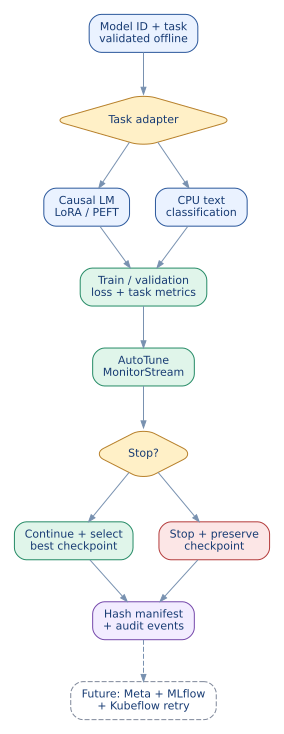{.diagram}

| Training mode | Source file | Example repository | Outputs | Current status |
|---|---|---|---|---|
| Causal language model / LoRA | `autotune/lora_gpu.py` | `sshleifer/tiny-gpt2` | PEFT adapters, Trainer checkpoints, JSONL metrics | Source + offline tests; live run pending |
| Text classification / full fine-tune | `autotune/hf_classification.py` | `google/bert_uncased_L-2_H-128_A-2` | Model weights, label mapping, Trainer checkpoints, JSONL metrics | Source + offline tests; live run pending |
| Vision / audio / sequence-to-sequence | Future adapters | ViT / Whisper / T5 | Task-specific | Not implemented |

**License distinction:** publicly downloadable models are not automatically open source. Inspect the repository's license, usage restrictions, safety notices and gated-access requirements before training or distributing any derivatives.

## 9.2 Architecture and interfaces

The new `autotune/hf_models_cli.py` detects the task from YAML. With no flags, it **only performs offline preflight**, hashing the actual dataset files, checking dataset separation, model IDs, labels, parameter ranges and evaluation schedule. No model weights are downloaded at preflight.

For `causal-lm`, the CLI routes to the existing PEFT LoRA pipeline and verifies adapter manifests. The model's `hf.target_modules` are architecture-specific; blindly applying `c_attn` from GPT-2 to a BERT model will fail. The CLI limits the CPU LoRA path to configurations explicitly marked as CPU and rejects 4-bit quantization without an appropriate GPU.

For `text-classification`, the CLI loads `AutoTokenizer`, `AutoModelForSequenceClassification`, and `Trainer` only after `--execute`. Its JSONL rows must have a nonempty `text` and a string/integer `label`. The training split determines the label-to-index mapping. Validation labels must all appear in training, and duplicate text across splits is rejected. Labels and held-out records should represent a genuine task, not a tiny synthetic quality benchmark.

The classification callback logs training losses, validation loss and accuracy, then passes **paired training/validation observations** into the existing `MonitorStream`. Monitoring can request an early stop, but the agent does not yet approve a patch or schedule another real HF attempt. The output contains a saved best model, complete Trainer checkpoint metadata, run receipt and SHA-256 artifact manifest.

## 9.3 Windows PowerShell commands (no dedicated GPU)

From the extracted project root:

```powershell
py -3.11 -m venv .venv-hf
.\.venv-hf\Scripts\python.exe -m pip install -r requirements-lora.txt
.\.venv-hf\Scripts\python.exe -m pytest -q

# Offline config + dataset preflight (no download)
.\.venv-hf\Scripts\python.exe -m autotune.hf_models_cli --config config/hf_bert_tiny_cpu.yaml

# Explicit CPU fine-tuning (downloads a small public model)
.\.venv-hf\Scripts\python.exe -m autotune.hf_models_cli --config config/hf_bert_tiny_cpu.yaml --execute --output outputs/bert-tiny-cpu-01

# Offline artifact-integrity verification
.\.venv-hf\Scripts\python.exe -m autotune.hf_models_cli --config config/hf_bert_tiny_cpu.yaml --verify outputs/bert-tiny-cpu-01/best_model
```

For causal language modeling, substitute `--config config/lora_public_cpu.yaml` in the first two run commands; it uses PEFT LoRA on `sshleifer/tiny-gpt2`. The existing `autotune.lora_cli` remains supported. An initial model download requires access to Hugging Face unless artifacts are already locally cached. Training on real user data needs consent, privacy checks, sensible split sizes, task-specific metrics, and independent test evaluation before promotion.

## 9.4 How an external Hugging Face repository is handled

| Stage | Guardrail |
|---|---|
| Select | Verify repository ID, task/model compatibility, license and access |
| Validate | Enforce config limits, independent train/validation splits, stable label map |
| Acquire | Explicit `--execute`; `trust_remote_code=False`; prefer pinned model revision |
| Fine-tune | Per-task Trainer API, CPU budget, bounded steps and evaluation frequency |
| Monitor | Window-aligned training/validation metrics, conservative stopping |
| Recover | Integrity hash of checkpoints; explicit compatible resume; no automatic rewrite yet |
| Promote | Not implemented: future untouched test set and human/policy approval |

## 9.5 Known limitations and implementation work ahead

This version does **not** implement vision, speech, token labeling, automatic dataset downloading, broad model-family compatibility detection, hosted Meta agent calls within HF training, MLflow tracking server integration, or Kubeflow-managed retries. It does not report a live BERT/LoRA training benchmark. The sample dataset has only 16 combined records and is a plumbing demonstration, not a representative learning task. The standalone classification model stores full model weights, while the causal-LM adapter stores PEFT LoRA weights. Their checkpoints are not mutually interchangeable.

**Next acceptance gate:** run CPU BERT classification and tiny GPT-2 LoRA once on the user's Windows machine; check actual losses, reload/verify artifacts, and exercise an explicitly selected full Trainer checkpoint resume. Then connect both task adapters to the durable Phase 3 state machine, Meta recommendations, and Phase 6 MLflow tracking. Do not automatically requeue real training jobs until their termination and resume semantics are independently validated.

Further implementation instructions and JSONL schemas: `docs/HF_OPEN_SOURCE_MODELS.md`.


<div class="page-break"></div>

# 11. v0.8.3: Optional Unsloth GPU backend (2026-11-02)

**Architectural decision:** preserve the working Hugging Face + PEFT CPU trainer and add Unsloth as an opt-in GPU accelerator. Unsloth's CPU-capable inference/data features should not be mistaken for support for ordinary Unsloth accelerated fine-tuning without a GPU. The new code includes offline preflight and a fail-closed CUDA/ROCm check. No real Unsloth training or agent-directed retry has been executed.

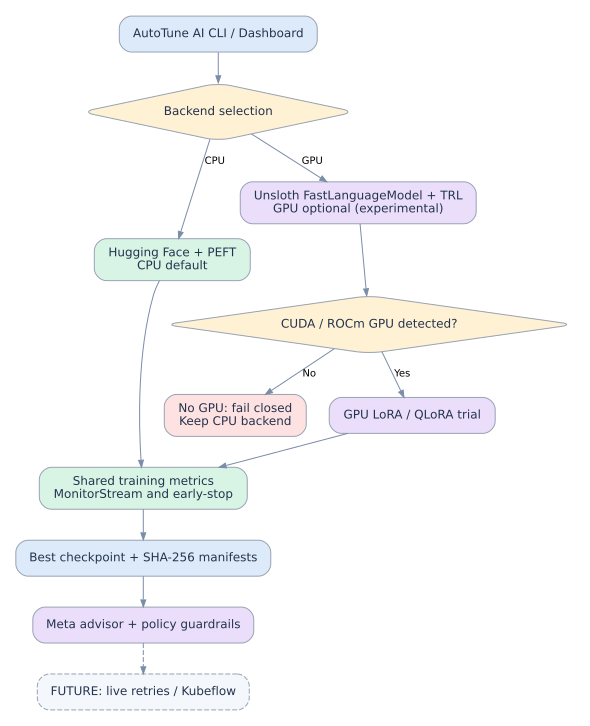{.diagram}

The experimental `autotune.unsloth_cli` runs **preflight by default**, validating model repository ID, dataset hashes, configuration, LoRA targets and evaluation cadence. `--execute` explicitly requests GPU-only fine-tuning. The runtime uses Unsloth's `FastLanguageModel`, TRL `SFTTrainer`, shares `MonitorStream` and saves SHA-256 manifests. The full GPU path needs actual version-matched installation and end-to-end hardware testing. Unsloth is never imported during preflight, and the existing `autotune.hf_models_cli` is unchanged.

The current local test suite passed **193 tests** (185 inherited, eight new), including rejection of unavailable GPU and unsafe HF repo identifiers. GPU training and checkpoint-resume semantics remain unverified; do not describe them as production ready.

**Windows CPU commands:** `python -m autotune.unsloth_cli --config config/lora_unsloth_gpu.example.yaml` and `python -m autotune.unsloth_cli --config config/lora_public_cpu.yaml` (offline only). Continue CPU fine-tuning with `autotune.hf_models_cli`. See `docs/UNSLOTH_OPTIONAL_BACKEND.md` for details and source links.


---

# Phase 5E update - v0.8.6 (2026-11-02)

# Phase 5E - Real Hugging Face Self-Healing Controller (v0.8.6)

## Scope and evidence

**Implemented and offline-tested:** The new `autotune.hf_selfheal` module controls serial training attempts through the existing `lora_gpu.run_lora` trainer, audits real checkpoint manifests, uses existing live metrics/monitoring to choose whether to retry, requests allowlisted numeric advice, versions YAML, and selects the lowest observed validation loss. 15 additional controller tests use fake Hugging Face Trainer outputs with real hash manifests. **208 passed locally** including the previous 193 tests. **Live two-attempt HF CPU execution is still pending on the user's Windows machine.** This milestone is not MLflow, Kubeflow, or hosted Meta API validation.

The source version is **0.8.6**. Historical 0.8.5 was documentation-only.

## Architecture

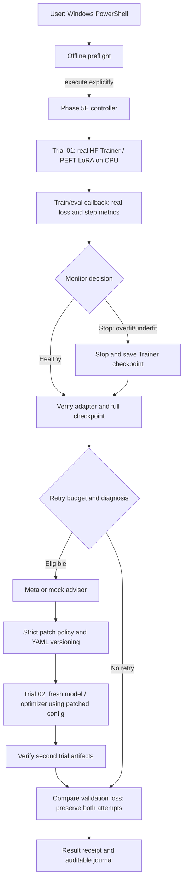

## What counts as self-healing

A genuine *detected* failure must arise from paired real training/validation measurements as judged by `MonitorStream`. The system stops at a Trainer evaluation/checkpoint boundary, verifies the resulting adapter and full checkpoint, requests a constrained proposed patch, and begins a **new** training attempt from base weights. Hyperparameter changes such as LoRA dropout are not assumed to be optimizer-resumable: a new run gets a new optimizer. The system retains all previous attempts and never auto-deploys.

For a reproducible controller acceptance test on this tiny dataset, `--fault-inject-overfit` explicitly induces a stop at the first real evaluation, **while retaining the genuine measured metrics**. This is a *synthetic trigger*, clearly logged as `fault_injection_stop`; it is NOT observed overfitting. Trial 2 runs with new validated hyperparameters. Use this test only for controller integration and checkpoint integrity, not model quality.

## Windows commands (from project root)

Preserve your prior outputs, especially `outputs/gpt2-cpu-01` and `outputs/gpt2-resume-probe-01`.

```powershell
.\.venv\Scripts\python.exe -m pytest -q
.\.venv\Scripts\python.exe -m autotune.hf_selfheal --config config/lora_selfheal_cpu.yaml
# Explicit real single/two-attempt training; new unique workspace
.\.venv\Scripts\python.exe -m autotune.hf_selfheal --config config/lora_selfheal_cpu.yaml --execute --workspace outputs/hf-selfheal-cpu-01
# For guaranteed controlled stop+recovery acceptance, choose another fresh workspace:
.\.venv\Scripts\python.exe -m autotune.hf_selfheal --config config/lora_selfheal_cpu.yaml --execute --fault-inject-overfit --workspace outputs/hf-selfheal-injection-01
Get-Content outputs\hf-selfheal-injection-01\controller_result.json -Raw
Get-Content outputs\hf-selfheal-injection-01\controller_events.jsonl
Get-Content outputs\hf-selfheal-injection-01\trial-01.advisor_decision.json -Raw
```

If `resume_proof.json` was not previously checked, inspect it too:

```powershell
Get-Content outputs\gpt2-resume-probe-01\resume_proof.json -Raw
```

## Trust boundary and operational limitations

- Offline preflight never downloads weights or writes training outputs.
- `--execute` is required for any HF download/training. No automatic background work.
- Source workspace must be empty. In-place rerun into a completed or blocked workspace is refused.
- Up to 3 sequential attempts, capped by `safety.max_trials` in config (example: 2). No unbounded loops or recursive runs.
- Only two monitored diagnoses (`overfit`, `underfit`) are eligible for autonomous patch-and-retry. `diverged` and other states do not authorize it.
- The only mutable fields are allowlisted bounded numeric training hyperparameters, validated twice. No arbitrary code changes, shell access, or Git commits by the model.
- Original training and validation data are fingerprinted and must be identical across attempts. Model, revision, device, and quantization may not change.
- Full Trainer checkpoint and final LoRA adapter manifests are reverified after every attempt. Manifests are integrity checks, not signatures or attestation.
- Errors mark controller `blocked`; operators inspect log and use a fresh experiment folder. Automatic crash recovery / idempotent remote jobs remain future work.
- No proof of generalization from 4 training and 2 validation examples; no independent held-out test, registry, MLflow server, Kubeflow, Katib, or deployment validation.
- The generic `hf_models_cli` and Unsloth examples remain unchanged. Phase 5E currently orchestrates **causal-LM PEFT LoRA on CPU**, not BERT classification or GPU Unsloth.

## Acceptance checklist

1. Windows test suite runs and skipped tests are named and inspected.
2. Offline preflight reports CPU, 2 allowed attempts, correct dataset hashes.
3. Controlled real HF run returns `attempt_count: 2`, receipts for both trials, explicit `fault_injection_used: true` and verified checkpoint/adapter manifests.
4. `trial-01.advisor_decision.json` records a safe patch and both YAML snapshots have different configuration hashes but identical dataset hashes.
5. `controller_events.jsonl` retains ordered events; `controller_result.json` compares validation losses without overwriting prior outputs.
6. Separate genuine monitor-induced early stop should be tested later; do not infer it from fault injection.
7. User supplies `resume_proof.json` before we conclude restored optimizer/scheduler details.

## Next phases

Phase 5F: real HF failure injection & crash reconciliation, independent evaluation and multi-dataset tests. Phase 6: durable MLflow tracking. Phases 7-8: CPU-cluster Kubeflow/Katib. Optional GPU Unsloth/Meta Llama are nonblocking.


# v0.8.7 Phase 6A - Optional local MLflow lineage

# Phase 6A: Opt-in MLflow experiment tracking (AutoTune AI v0.8.7)

## Current verified boundary

- User independently ran the **v0.8.6** real CPU self-healing experiment in Windows VS Code on November 2, 2026: **207 passed, 1 skipped**, followed by two real PEFT LoRA training attempts using `sshleifer/tiny-gpt2` and a deliberately injected `overfit` stop on trial 1. Trial 2 completed normally.
- User's trial-1 and trial-2 validation losses: `10.365184783935547` and `10.365181922912598`, respectively. Difference ~`2.86e-6`, not meaningful model-quality evidence. `promotion_approved: false`.
- Phase 6A's additional MLflow code passed **216 local offline tests** (208 inherited + 8 new). These use a fake MLflow client and, for controller tests, a fake training boundary. **No live MLflow tracking-server session or database write has been verified** in this build environment.
- Hosted Meta advisor still unverified; mock default remains. Unsloth GPU remains optional and unverified. The earlier step-2-to-step-4 actual Trainer resume succeeded; exact `resume_proof.json` contents have not been supplied.

## What is added

`autotune/hf_mlflow.py` is an optional `MlflowClient` reporter integrated into `autotune/hf_selfheal.py` via `--mlflow-uri` and `--mlflow-experiment`. When opt-in is enabled, the controller creates one parent MLflow run and one child MLflow run per real training attempt. Each trial logs its validated config, scalar training and validation metrics, best validation loss, monitoring decisions, config hash, diagnosis, injection flag, and audit manifests. The controller logs the selection receipt, trial lineage, and non-promotion status.

**Intentional security and reproducibility boundaries:**

- If `--mlflow-uri` is omitted, no MLflow package import or network access occurs. An environment variable alone does not opt in.
- Neither weight tensors nor optimizer `.pt` files nor `.safetensors` are uploaded by this reporter. MLflow receives JSON/YAML metadata and hash manifests only; full weight files remain on the user's local disk. Model registration and remote artifact uploads are separate future, explicit actions.
- The existing local `controller_result.json`, JSONL event journal, and per-trial manifests remain the authoritative evidence. An enabled-but-failing tracker blocks the controller and requires a **new workspace**; it will not silently claim successful tracking or launch speculative retries.
- The current reporter logs metrics after an attempt finishes, not live during every training step. Real-time streaming is a later Phase 6B feature.
- The local web server should bind only to `127.0.0.1`. Avoid sending private dataset paths/configuration to a remote server without authorization and secure transport.

## Windows PowerShell acceptance test

**1. Apply the v0.8.7 patch without replacing existing `outputs` or `.venv`.**

**2. Install the optional MLflow dependency:**

```powershell
.\.venv\Scripts\python.exe -m pip install -r requirements-mlflow.txt
.\.venv\Scripts\python.exe -m pytest -q
```

**3. In one VS Code PowerShell terminal start the local MLflow server:**

```powershell
.\.venv\Scripts\mlflow.exe server --backend-store-uri sqlite:///mlflow.db --host 127.0.0.1 --port 5000
```

Leave this terminal open. Open `http://127.0.0.1:5000` locally. MLflow's backend is local SQLite; it does not require Docker, Kubernetes or a GPU. Consult the MLflow tracking server guide: https://mlflow.org/docs/latest/tracking/server/.

**4. In a second terminal, run a NEW real CPU experiment with logging enabled:**

```powershell
.\.venv\Scripts\python.exe -m autotune.hf_selfheal --config config/lora_selfheal_cpu.yaml --execute --fault-inject-overfit --workspace outputs/hf-selfheal-mlflow-01 --mlflow-uri http://127.0.0.1:5000 --mlflow-experiment AutoTune-AI-CPU
```

Use a fresh workspace name if that folder already exists. The above is an **intentional fault-injection acceptance test**, not proof of natural overfitting. This will download or reuse cached tiny-GPT2 weights, train on CPU, and attempt to log to your local MLflow server. It will not overwrite previous successful experiments.

**5. Acceptance gates:**

- CLI `ok: true`, `attempt_count: 2`, `promotion_approved: false`.
- MLflow UI experiment `AutoTune-AI-CPU` contains **one parent controller run and two child trial runs** (`mlflow.parentRunId` tags).
- Each child has a config SHA256, scalar metrics and verified manifest artifacts; parent has final selected best validation loss, best-trial tag, and `controller_result.json`.
- No `.safetensors` or `.pt` weight upload in MLflow artifacts.
- Local `controller_events.jsonl` includes `mlflow_controller_created` and `mlflow_trial_created` with run IDs.

If the server is unavailable, inspect the local `controller_state.json` and `controller_events.jsonl` for `blocked`. **Do not rerun into the same directory**; start the server, investigate, then use a new workspace. Do not delete prior outputs.

## Next steps

Phase 6B: real MLflow server verification, live-step logging, read-only run comparison dashboards, failed-run reconciliation and offline exports. Phase 7: local CPU Kubernetes/Kubeflow Pipelines; Phase 8: Katib tuning. Hosted Meta reasoning and genuine naturally detected anomalies require their own verification.


---

# Phase 6B - v0.9.0: Read-Only Experiment Dashboard (2026-11-02)

The existing real CPU trainer and MLflow reporter are unchanged. New FastAPI read-only endpoints access the existing MLflow Tracking SDK on a fixed localhost port and return only vetted experiment metadata, metric histories, run status and lineage. A Next.js TypeScript application queries the API from Server Components for local experiments, detailed runs, and loss curves. The security boundary disallows MLflow target URL injection, raw filesystem paths, artifact downloads, write routes, unauthorized origins, non-allowlisted metrics, and unfiltered exception messages. Local services are not authenticated and must not be exposed to networks.

See editable diagram `docs/diagrams/viewer_phase6b_v090.mmd`, the Graphviz source and `docs/PHASE6B_DASHBOARD_RUNBOOK.md`.

**Verified:** full local Python test suite 238 passed (new API security and response tests 22); existing CPU training behavior retained. **Not verified:** live Windows MLflow->FastAPI->Next.js and Next.js npm build (installation timed out in package building container). **Next:** acceptance in user's Windows setup then S0 vulnerability scanner engineering.
