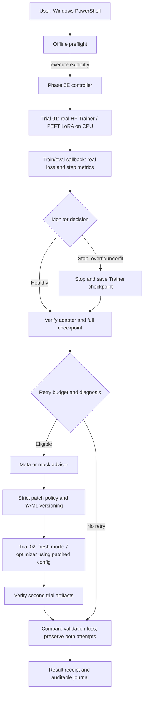

# Phase 5E - Real Hugging Face Self-Healing Controller (v0.8.6)

## Scope and evidence

**Implemented and offline-tested:** The new `autotune.hf_selfheal` module controls serial training attempts through the existing `lora_gpu.run_lora` trainer, audits real checkpoint manifests, uses existing live metrics/monitoring to choose whether to retry, requests allowlisted numeric advice, versions YAML, and selects the lowest observed validation loss. 15 additional controller tests use fake Hugging Face Trainer outputs with real hash manifests. **208 passed locally** including the previous 193 tests. **Live two-attempt HF CPU execution is still pending on the user's Windows machine.** This milestone is not MLflow, Kubeflow, or hosted Meta API validation.

The source version is **0.8.6**. Historical 0.8.5 was documentation-only.

## Architecture



## What counts as self-healing

A genuine *detected* failure must arise from paired real training/validation measurements as judged by `MonitorStream`. The system stops at a Trainer evaluation/checkpoint boundary, verifies the resulting adapter and full checkpoint, requests a constrained proposed patch, and begins a **new** training attempt from base weights. Hyperparameter changes such as LoRA dropout are not assumed to be optimizer-resumable: a new run gets a new optimizer. The system retains all previous attempts and never auto-deploys.

For a reproducible controller acceptance test on this tiny dataset, `--fault-inject-overfit` explicitly induces a stop at the first real evaluation, **while retaining the genuine measured metrics**. This is a *synthetic trigger*, clearly logged as `fault_injection_stop`; it is NOT observed overfitting. Trial 2 runs with new validated hyperparameters. Use this test only for controller integration and checkpoint integrity, not model quality.

## Windows commands (from project root)

Preserve your prior outputs, especially `outputs/gpt2-cpu-01` and `outputs/gpt2-resume-probe-01`.

```powershell
.\.venv\Scripts\python.exe -m pytest -q
.\.venv\Scripts\python.exe -m autotune.hf_selfheal --config config/lora_selfheal_cpu.yaml
# Explicit real single/two-attempt training; new unique workspace
.\.venv\Scripts\python.exe -m autotune.hf_selfheal --config config/lora_selfheal_cpu.yaml --execute --workspace outputs/hf-selfheal-cpu-01
# For guaranteed controlled stop+recovery acceptance, choose another fresh workspace:
.\.venv\Scripts\python.exe -m autotune.hf_selfheal --config config/lora_selfheal_cpu.yaml --execute --fault-inject-overfit --workspace outputs/hf-selfheal-injection-01
Get-Content outputs\hf-selfheal-injection-01\controller_result.json -Raw
Get-Content outputs\hf-selfheal-injection-01\controller_events.jsonl
Get-Content outputs\hf-selfheal-injection-01\trial-01.advisor_decision.json -Raw
```

If `resume_proof.json` was not previously checked, inspect it too:

```powershell
Get-Content outputs\gpt2-resume-probe-01\resume_proof.json -Raw
```

## Trust boundary and operational limitations

- Offline preflight never downloads weights or writes training outputs.
- `--execute` is required for any HF download/training. No automatic background work.
- Source workspace must be empty. In-place rerun into a completed or blocked workspace is refused.
- Up to 3 sequential attempts, capped by `safety.max_trials` in config (example: 2). No unbounded loops or recursive runs.
- Only two monitored diagnoses (`overfit`, `underfit`) are eligible for autonomous patch-and-retry. `diverged` and other states do not authorize it.
- The only mutable fields are allowlisted bounded numeric training hyperparameters, validated twice. No arbitrary code changes, shell access, or Git commits by the model.
- Original training and validation data are fingerprinted and must be identical across attempts. Model, revision, device, and quantization may not change.
- Full Trainer checkpoint and final LoRA adapter manifests are reverified after every attempt. Manifests are integrity checks, not signatures or attestation.
- Errors mark controller `blocked`; operators inspect log and use a fresh experiment folder. Automatic crash recovery / idempotent remote jobs remain future work.
- No proof of generalization from 4 training and 2 validation examples; no independent held-out test, registry, MLflow server, Kubeflow, Katib, or deployment validation.
- The generic `hf_models_cli` and Unsloth examples remain unchanged. Phase 5E currently orchestrates **causal-LM PEFT LoRA on CPU**, not BERT classification or GPU Unsloth.

## Acceptance checklist

1. Windows test suite runs and skipped tests are named and inspected.
2. Offline preflight reports CPU, 2 allowed attempts, correct dataset hashes.
3. Controlled real HF run returns `attempt_count: 2`, receipts for both trials, explicit `fault_injection_used: true` and verified checkpoint/adapter manifests.
4. `trial-01.advisor_decision.json` records a safe patch and both YAML snapshots have different configuration hashes but identical dataset hashes.
5. `controller_events.jsonl` retains ordered events; `controller_result.json` compares validation losses without overwriting prior outputs.
6. Separate genuine monitor-induced early stop should be tested later; do not infer it from fault injection.
7. User supplies `resume_proof.json` before we conclude restored optimizer/scheduler details.

## Next phases

Phase 5F: real HF failure injection & crash reconciliation, independent evaluation and multi-dataset tests. Phase 6: durable MLflow tracking. Phases 7-8: CPU-cluster Kubeflow/Katib. Optional GPU Unsloth/Meta Llama are nonblocking.
