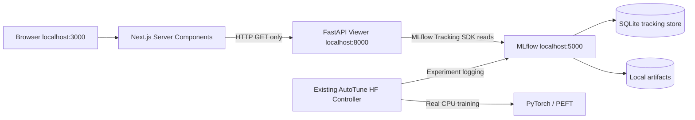

# AutoTune AI Phase 6B - Read-only MLflow Experiment Dashboard (v0.9.0)

## Purpose

Add a Windows CPU-first dashboard without changing the verified real Hugging Face training, checkpoint integrity, or Phase 6A MLflow logger. The backend is a **read-only, localhost-only FastAPI facade** for the existing MLflow server; the frontend is a **Next.js App Router / TypeScript** experiment viewer.

## Architecture



The new install requirements enforce MLflow 3.17.2 or newer within the 3.x series, based on the October 2026 patch releases. This is a minimum-version guard, not a vulnerability scan or a lockfile. Check existing local version and known advisories before exposing services.

## Three-terminal start - Windows PowerShell

Work from the project root `autoHeal_finetune`. Apply the patch on a backed-up copy of existing source; **never replace previous `outputs/`**.

**Terminal A - MLflow (already installed during Phase 6A)**

```powershell
.\.venv\Scripts\mlflow.exe server --backend-store-uri sqlite:///mlflow.db --host 127.0.0.1 --port 5000
```

**Terminal B - FastAPI read-only proxy**

```powershell
.\.venv\Scripts\python.exe -m pip install -r requirements-viewer.txt
$env:AUTOTUNE_MLFLOW_URI = "http://127.0.0.1:5000"
.\.venv\Scripts\python.exe -m uvicorn autotune.viewer_api:app --host 127.0.0.1 --port 8000
```

Verify `http://127.0.0.1:8000/api/health` and `http://127.0.0.1:8000/api/experiments`.

**Terminal C - Next.js UI**

```powershell
cd .\web
npm install
npm run dev
```

Open `http://127.0.0.1:3000` in a local browser. Node.js 20.9+ recommended for Next.js 16. Internet is needed to install npm packages on first setup. The build environment for this package could not complete `npm install`, so frontend runtime/build remains **unverified** until executed on Windows. The Python API tests are independently verified.

## Available read-only APIs

| Endpoint | Purpose | Constraints |
|---|---|---|
| `GET /api/health` | API readiness (not MLflow health) | Honest `mlflow: not probed` |
| `GET /api/experiments` | List at most 100 experiments | No arbitrary query strings |
| `GET /api/experiments/{id}/runs?limit=N` | Latest runs | 1..100, numeric experiment ID |
| `GET /api/runs/{run_id}` | Run details | 32-digit hex run ID |
| `GET /api/runs/{run_id}/metrics/{name}` | Metric history | Whitelisted metrics, max 250 points |

The API intentionally has **no endpoints** for filesystem reads, artifact downloads, imports, training submissions, model deployment, uploads, secret access or remote URLs.

## Security boundary

- Restrict MLflow and both app servers to `127.0.0.1`; these services are **not authenticated** for multi-user environments.
- The viewer hard-rejects any MLflow target other than `http://127.0.0.1:<port>`, excluding credentials, paths, queries and fragments.
- Only explicit tags, parameters and numeric metrics are included in API JSON. No raw artifact paths, user-defined secrets or arbitrary MLflow metadata are passed through.
- Trusted host allowlist and strict CORS apply. Neither substitutes for authentication.
- No shell command execution, LLM agent write action, training trigger or deployment permission exists in the viewer.
- API errors are sanitized; MLflow internal exception strings are not forwarded.
- Dependencies have not been scanned for CVEs. Run `python -m pip_audit` and `npm audit` after installation and resolve findings; scanners are **not yet embedded into a CI gate**.
- Use versioned lockfiles and reproducible hash pinning before any externally shared deployment. This local prototype is not hardened for production.

## Acceptance checks

1. `python -m pytest -q` passes existing and new tests.
2. API returns `status: ready`, then existing AutoTune-AI-CPU experiment and the three MLflow run records from the earlier Phase 6A acceptance.
3. Dashboard renders run names, status, best validation loss, diagnosis and injection flags; run details display bounded loss trends.
4. Invalid IDs and unapproved metrics are rejected. POST/DELETE endpoints return 405.
5. No private metadata or weight files appear in API responses.
6. Disconnect MLflow: API responds 503 without leaking underlying service errors. Previously logged training files remain unchanged.

## What this phase does NOT prove

- The user's live Windows dashboard rendering; frontend `npm install` and `next build` are still pending.
- Multi-user authentication/authorization, vulnerability scanning, secure deployment, real-time streams, remote GPU orchestration, Kubeflow, Katib, or naturally occurring overfit-driven improvement.
- Previously recorded loss difference is too small to establish model-quality improvement. Fault injection remains labeled.

## Next sprint

S0 security gate implementation (dependency scanning with machine-readable reports, dataset PII/poisoning triage, immutable model source intake, auditable block/quarantine); then Phase 6C live telemetry and authorized job-control design; then Phase 7 Kubeflow and Phase 8 Katib.
