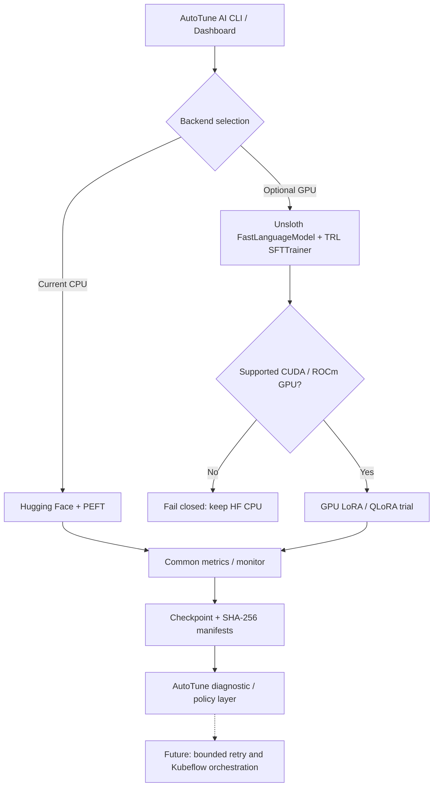

# AutoTune AI v0.8.3 - Optional Unsloth GPU backend

**Decision (2026-11-02):** Add Unsloth as a separate, explicitly invoked *experimental GPU backend*. Do not replace or break the independently verified Windows CPU Hugging Face + PEFT path. Unsloth's CPU support for chat/data preparation should not be confused with Unsloth Core GPU-accelerated fine-tuning.

## What is integrated today

- `autotune/unsloth_backend.py`: Offline Hugging Face/LoRA plan validation, strict repository-ID checks, explicit PyTorch NVIDIA/ROCm GPU gate, and GPU-only SFT code path using `FastLanguageModel` and TRL `SFTTrainer`.
- `autotune/unsloth_cli.py`: Preflight by default. Training requires `--execute` and a fresh empty output folder.
- `config/lora_unsloth_gpu.example.yaml`: GPU-only example using small public model ID `unsloth/Qwen3-0.6B`. Review actual model license, model availability and hardware compatibility before execution.
- Existing metrics `MonitorStream`, per-evaluation decisions, and existing SHA-256 LoRA adapter / Trainer checkpoint artifact verification are called from the experimental training code.
- Explicitly **no automatic agent-driven retraining, no certified full-state resume, no silent CPU fallback, no model promotion** on this experimental backend. The code path needs a real supported GPU end-to-end test and may require Unsloth/TRL version-specific changes.

## Windows CPU instructions (current machine)

From `autoHeal_finetune` project root, apply only the new files from the v0.8.3 patch. Preserve `.venv`, `outputs/`, all existing YAML and training artifacts.

```powershell
# Safe offline preflight of the GPU template: NO download or training
.\.venv\Scripts\python.exe -m autotune.unsloth_cli --config config/lora_unsloth_gpu.example.yaml

# CPU config: explicitly reports that Unsloth GPU training is unavailable
.\.venv\Scripts\python.exe -m autotune.unsloth_cli --config config/lora_public_cpu.yaml

# Keep using the verified Hugging Face backend for real CPU training
.\.venv\Scripts\python.exe -m autotune.hf_models_cli --config config/lora_public_cpu.yaml

# Verify all local tests
.\.venv\Scripts\python.exe -m pytest -q
```

**Do not run** `--execute` for Unsloth on your CPU. If attempted, the runtime fails before model downloads or output creation when PyTorch sees no supported training GPU.

## Future supported GPU host

1. Use an isolated Python environment appropriate for the GPU driver, platform, and installed PyTorch CUDA or ROCm build. Read the latest official Unsloth installation instructions; avoid installing Unsloth directly into the working CPU `.venv`.
2. On AMD GPU, follow Unsloth's AMD-specific installation guide and verify that `torch.cuda.is_available()` is `True` (ROCm's PyTorch GPU interface uses `torch.cuda`). Merely having AMD integrated graphics is not sufficient.
3. Check `model.name`, license/access, tokenizer, GPU memory, LoRA `target_modules`, selected quantization, model revision, dataset hashes, and train/evaluation cadence.
4. Run the CLI without `--execute`. Only then execute in a fresh output directory:

```powershell
.\unsloth-venv\Scripts\python.exe -m autotune.unsloth_cli --config config/lora_unsloth_gpu.example.yaml
.\unsloth-venv\Scripts\python.exe -m autotune.unsloth_cli --config config/lora_unsloth_gpu.example.yaml --execute --output outputs/unsloth-gpu-01
```

On Linux/WSL use the analogous venv interpreter path. The sample is experimental and has not been GPU-run. If a supported GPU is not available, do not attempt an `--execute` command.

## Integration architecture



## Verification boundaries

| Level | Status |
|---|---|
| Current v0.8.2 user HF CPU LoRA and adapter reload | User verified; keep immutable |
| v0.8.3 Unsloth config and CPU fail-closed preflight | Locally tested; 193/193 suite tests passed |
| Unsloth real NVIDIA/AMD GPU SFT with checkpoint integrity | Not executed; runtime integration experimental |
| Unsloth optimizer/scheduler resume, agent-directed recovery, Kubeflow | Not yet integrated |

## Official sources

- Unsloth project + hardware / installation: https://github.com/unslothai/unsloth
- GPU requirements: https://unsloth.ai/docs/get-started/fine-tuning-for-beginners/unsloth-requirements
- Windows example: https://unsloth.ai/docs/get-started/install/windows-installation
- AMD GPU installation: https://unsloth.ai/docs/get-started/install/amd
- HF-compatible training: https://unsloth.ai/docs/get-started/fine-tuning-llms-guide
